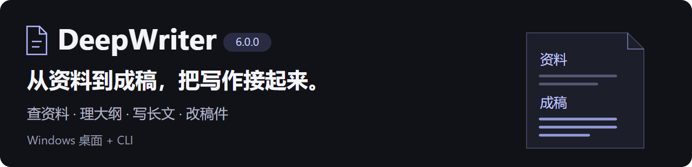
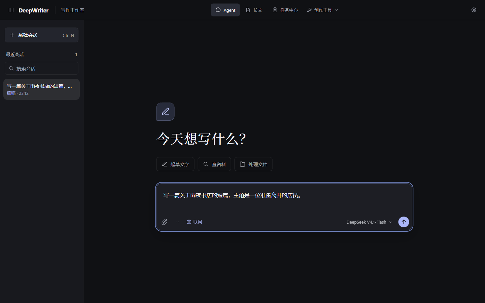
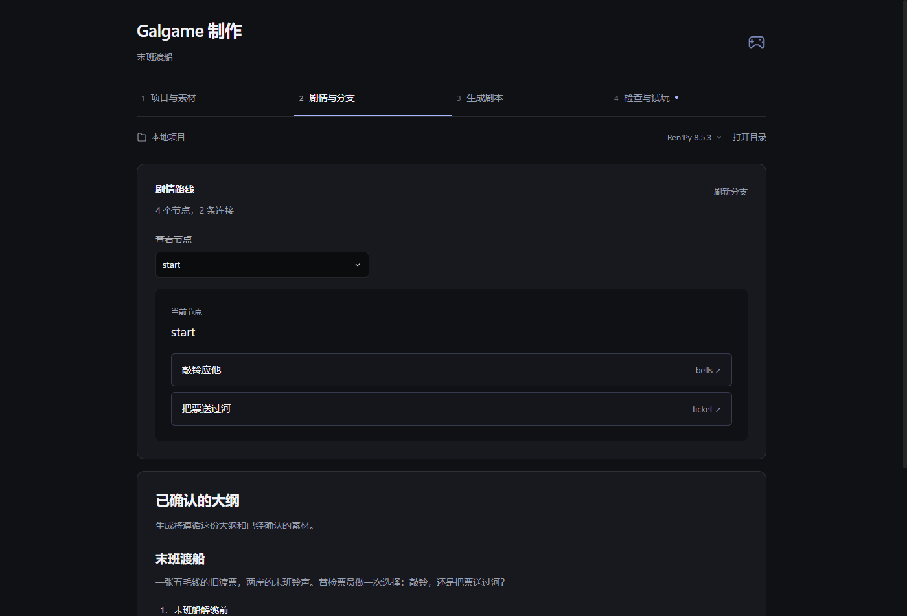
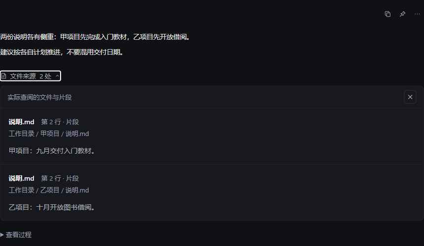
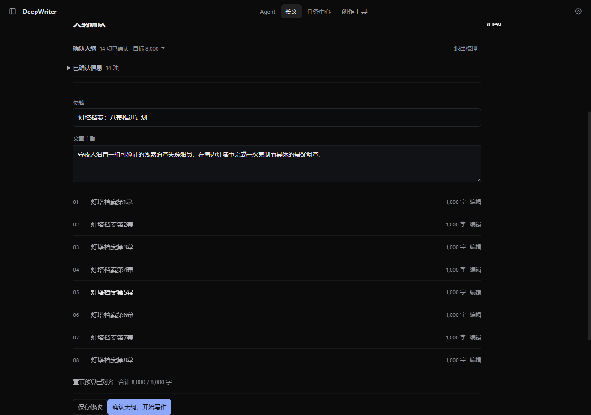
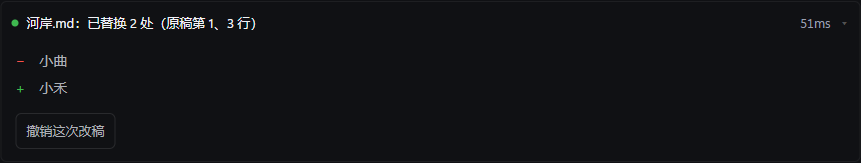

<div align="center">



**用 Agent 查资料、处理文件，用长文工作区把想法写成作品。**

### [下载完整包（桌面 + CLI）](https://github.com/jhdsmb-del/DeepWriter/releases/download/v6.0.0/DeepWriter-6.0.0-complete.zip)

[免安装版](https://github.com/jhdsmb-del/DeepWriter/releases/download/v6.0.0/DeepWriter-6.0.0-x64-portable.exe) · [安装版](https://github.com/jhdsmb-del/DeepWriter/releases/download/v6.0.0/DeepWriter-6.0.0-x64-setup.exe) · [全部版本](https://github.com/jhdsmb-del/DeepWriter/releases)

[桌面入门](#桌面三步开始) · [CLI 入门](#cli把写作带进终端) · [6.0.0 更新](docs/RELEASE_NOTES_6.0.0.md) · [反馈问题](https://github.com/jhdsmb-del/DeepWriter/issues)

</div>



## 从一个分支故事开始

在完整包里打开 **Galgame 制作 → 导入项目**，选 `examples/last-ferry`。这是一个有两个结局的小故事：最后一班渡船离岸前，你会替检票员敲铃，还是把那张旧票送过河？


- **读路线**：点「剧情与分支」，沿着玩家看到的选项逐个节点读；也可以在终端运行 `.\cli\deepwriter.cmd galgame routes .\examples\last-ferry`。
- **试玩**：为导入的项目选择本机 Ren’Py SDK，点「试玩原项目」，就能打开游戏窗口。
- **写自己的故事**：新建项目，放入人物、立绘和背景，回答剧情问题，确认大纲后生成剧本。检查通过，直接点「开始试玩」。



## 你来定方向，DeepWriter 接着做

写故事、做资料整理、起草指南，往往不止是问一次、答一次。DeepWriter 把读材料、梳理要求、确认大纲、写作和审改放在同一个工作流里。你可以从一句话开始，也可以带着一整份项目资料进来。

| 想做什么 | 这样开始 |
| --- | --- |
| 查资料、找原文 | 「找出这条说法最早的公开来源，给我原文链接。」 |
| 对照多份文档 | 「一起读前三份交接记录，列出柜号不一致的地方，附原句。」 |
| 把材料写成文章 | 进入 **长文**：「给第一次值夜班的同事写交接指南，只用笔记里的数据。」 |
| 认真写一个故事 | 进入 **长文**：「写一篇灯塔守夜人的小说，只写他亲眼看见的事。」 |
| 审改已有稿件 | 打开 **只读审阅**：「找出第三章视角跳转的句子，先给修改方案。」 |

## 资料读得进去，引用找得回来

把 Word 或 ZIP 拖进对话，或选好工作目录后直接点名文件。Agent 可以按文件名找资料、按原话搜上下文，再把多份稿件放在一起比较。Excel 可以按工作表与单元格读取，PowerPoint 按幻灯片提取正文；桌面也能读取 PDF 文字层与 EPUB 章节。

**答案里的“文件来源”，能带你回到当时读过的那一段。** 文件路径、行号和摘录一起保留，同名文件也能分清。查公开网页时，可以顺着来源链接读原文。



## 长文先想清楚，再一章章写下去

进入 **长文**，写下题目、读者和目标字数，添加参考材料。DeepWriter 会逐问澄清要求，和你确认事实、写法与大纲，再连续推进正文、审校和收尾。写说明文时围绕读者要完成的事，写小说时围绕人物与场景。

**逐问梳理 → 确认大纲 → 连续写作 → 审校与导出**



大纲可以改，章节有进度。写到一半需要离开，就保留任务，回来继续；连接中断后也可以恢复同一个任务。想先读已经完成的章节，到 **任务中心 → 任务详情 → 活动 → 另存草稿**。

## 改稿先看方案，每一笔都看得见

在 **设置 → 项目约定** 写下这份稿件的要求，例如「只写小禾亲眼看到的事」。然后打开 **更多工具 → 只读审阅**，让 Agent 找出问题、提出改法。看过方案，再点 **批准执行**。

改完展开记录，就能对照原文与新稿；想保留原来的写法，点 **撤销这次改稿**。



## 多步工作，不必反复交代

「读两份资料，整理修改建议，再核对全部交付项。」Agent 会把当前进度列在对话里。进行中想调整顺序，直接补一句「先核对乙组」，它会接着往下做。需要找回早先的细节，也可以让它查这次会话的原话。

写好的文件可以直接拿走：**右键回复里的文件名 → 打开文件**，或选择 **在文件资源管理器中显示**。任务中心集中查看状态、耗时、用量与费用，也提供恢复入口。

### 还有一间创作工具室

- **风格素材**：管理写作风格材料，供创作时使用。
- **Galgame**：新建或导入 Ren’Py 项目，配置角色、立绘和背景，梳理剧情分支、制作剧本并运行检查。
- **写作扩展**：安装和启用结构审阅、克制润色等技能，也可以使用稿件检查工具。

## 桌面：三步开始

1. **下载并打开。** Windows x64 用户可选上方的免安装版或安装版；完整包解压后，桌面程序在 `desktop` 文件夹里。
2. **接入你的模型。** 打开 **设置 → 模型与接口**。使用官方 DeepSeek 时选择内置供应商、填写 API Key 并选择模型；其他服务添加各自的 Base URL、API Key 和模型 ID。
3. **发出第一项任务。** 回到 Agent，从输入框的 **更多工具** 选择稿件目录。试试：「找出铜钥匙第一次出现的位置，引用前后原文。」要写长稿，就切到 **长文**。

输入框底部可切换模型、思考强度与联网状态。查资料使用当前已配置且支持联网的模型服务；运行记录和用量在 **任务中心** 查看。

[阅读完整桌面指南](docs/QUICKSTART.md)

## CLI：把写作带进终端

**完整包自带 CLI 和 Node 运行时，解压就能用。** 在解压目录打开 PowerShell，先配置模型。下面以官方 DeepSeek 为例：

```powershell
# 隐藏输入 API Key
$dwKey = Read-Host 'DeepWriter API Key' -AsSecureString
$env:DEEPWRITER_API_KEY = [System.Net.NetworkCredential]::new('', $dwKey).Password

# 保存模型配置，打开持续对话
.\cli\deepwriter.cmd config set --base-url https://api.deepseek.com --model deepseek-flash
.\cli\deepwriter.cmd
```

进入对话后，用 `/new` 新建会话、`/sessions` 查看列表、`/session ID` 切换会话、`/model ID` 换模型。生成中按 **Ctrl+C** 暂停，再继续输入。

也可以一条命令完成一项工作：

```powershell
# 处理工作目录里的资料
.\cli\deepwriter.cmd agent '概括当前目录的资料，指出还缺哪些来源。' --work-dir .

# 从任务文件读取要求，把最终回复保存到新文件
.\cli\deepwriter.cmd chat --input .\brief.txt --output .\reply.md --no-web

# 从逐问梳理开始，写一篇目标 8000 字的长文
.\cli\deepwriter.cmd write '写一个灯塔夜班的悬疑故事，只保留两位人物' --target 8000
```

看状态、查来源、接着写：

```powershell
.\cli\deepwriter.cmd list
.\cli\deepwriter.cmd status RUN
.\cli\deepwriter.cmd sources RUN
.\cli\deepwriter.cmd resume RUN
.\cli\deepwriter.cmd export RUN --output .\final.md
```

将 `RUN` 换成 `list` 返回的任务编号，输出文件使用新文件名。用完后可执行 `Remove-Item Env:DEEPWRITER_API_KEY` 清除当前终端中的 Key。桌面与 CLI 各自保存会话和模型配置。

[CLI 完整指南：自定义服务、持续会话、审改与脚本用法](docs/CLI.md)

## 6.0.0 更新

- **长回复更顺手。** 新推理、工具进度和文件回执到达时，已经显示的正文不会一遍遍重新排版。阅读位置、复制按钮和文件链接都留在原处。
- **剧本改动更好掌握。** 工作室先准备候选内容。导入已有项目时保留原来的开场，并给出新剧情文件与入口，由你决定在哪里接入。
- **桌面与终端读同一张图。** 工作室里点选路线，终端里查看节点、选择与行号；加 `--json` 可把路线交给自己的脚本。

[完整更新说明](docs/RELEASE_NOTES_6.0.0.md) · [全部变更](CHANGELOG.md)

## 文档与参与

| 使用 DeepWriter | 了解与参与项目 |
| --- | --- |
| [快速开始](docs/QUICKSTART.md) | [架构概览](docs/TECHNICAL_OVERVIEW.md) |
| [CLI 指南](docs/CLI.md) | [Agent 运行机制](docs/HARNESS_5.0.md) |
| [运维与恢复](docs/OPERATIONS.md) | [贡献指南](CONTRIBUTING.md) |
| [隐私说明](docs/PRIVACY.md) | [安全反馈](SECURITY.md) |

### 从源码运行

安装 Node.js 22.13+ 和 npm，然后运行：

```powershell
git clone https://github.com/jhdsmb-del/DeepWriter.git
Set-Location DeepWriter
npm ci
npm run dev
```

DeepWriter 使用 Electron、React 与 TypeScript，桌面与 CLI 共用运行引擎和长文流程。项目采用 [MIT 许可证](LICENSE)。终端交互参考 [Pi](https://github.com/earendil-works/pi) 与 [ZCode](https://github.com/zai-org/ZCode)，模型规格目录来自 [models.dev](https://models.dev)。

