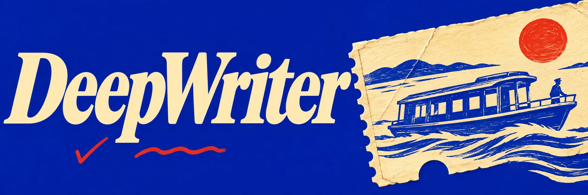
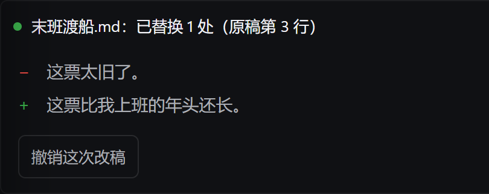

# 

Windows 和命令行上的文本写作助手。用自己的模型翻阅本地资料、修改稿件，或从大纲开始逐章写作。

**[下载 Windows 安装版](https://github.com/jhdsmb-del/DeepWriter/releases/download/v8.1.0/DeepWriter-8.1.0-x64-setup.exe)** · [免安装版](https://github.com/jhdsmb-del/DeepWriter/releases/download/v8.1.0/DeepWriter-8.1.0-x64-portable.exe) · [完整包（桌面＋CLI）](https://github.com/jhdsmb-del/DeepWriter/releases/download/v8.1.0/DeepWriter-8.1.0-complete.zip)

<details>
<summary>用命令行下载</summary>

装有 GitHub CLI 的 Windows 用户可以在 PowerShell 里下载并解压完整包：

```powershell
gh release download v8.1.0 -R jhdsmb-del/DeepWriter -p '*-complete.zip'
Expand-Archive .\DeepWriter-8.1.0-complete.zip -DestinationPath .\DeepWriter
```

</details>

安装版会在后台下载后续版本，等你点「重启并安装」才会安装。第一次打开，去 **设置 → 模型与接口** 选服务商、填 API Key。回到 **Agent → 更多工具**，选中稿件所在的目录，就可以直接提文件名了。[桌面入门](docs/QUICKSTART.md) · [CLI 配置](docs/CLI.md)

## 末班船到底几点开？

把完整包里的 `examples/east-bank` 设为 Agent 工作目录，问：「旧牌写的几点，后来改成几点，船最后几点离岸？分别给我原文。」

[临时班次单（Word）](examples/east-bank/night-timetable.docx) 写的是计划，[值班簿](examples/east-bank/duty-note.md) 记的是实况。原计划 **21:40**，改点 **21:55**，真正离岸是 **22:03**。展开回复里的 **文件来源**，可以逐条对照。把工作目录换成自己的资料夹，就能用同样的方法核对访谈稿、通知和会议纪要。

## 改一句对白

《末班渡船》里，有人把一张五毛钱的旧船票递给检票员。草稿里他只说「这票太旧了」。把这句话换成「这票比我上班的年头还长」，就不必再解释他在渡口干了多久。

展开 **查看过程**，能看到改了哪一行。觉得原来更好，点 **撤销这次改稿**。



整章审稿时，可以先开 **更多工具 → 只读审阅**，让它指出哪几句写出了人物不可能知道的事。看过原句和建议，再决定改不改。

## 从资料写一篇长稿

把访谈 Word、旧稿或一包 ZIP 资料拖进对话，先问一个能查回原文的问题，比如「两份交接记录里的日期哪里不一样？把原句列给我」。展开回复里的 **文件来源**，能看到所用的文件和摘录；文本文件还会标出行号。

要写正文，切到 **长文**，给出读者和目标字数。DeepWriter 会逐个提问，再把大纲交给你改。点 **确认大纲，开始写作** 后会接着写各章；中途想拿走已完成的部分，在 **任务中心 → 任务详情 → 活动** 选 **另存草稿**。

长稿不用先导出。在 **阅读已收稿** 里搜章名、按页读，退出阅读就能回到原来的写作会话。


## 试玩《末班渡船》

> 末班船解缆前，油漆工跑来，把一张五毛钱的旧渡票拍在窗口。


完整包附带《末班渡船》的剧本和素材。在 **创作工具 → Galgame → 导入现有项目** 选 `examples/last-ferry`，选好本机 Ren’Py SDK，点 **试玩原项目**。想先读一行？下面两个选项和游戏里一样：

<details>
<summary>敲铃应他</summary>

检票员第一次没照时刻表敲铃。两短，一长。隔着水，第三声碰到了第三声。

</details>

<details>
<summary>把票送过河</summary>

检票员把票夹进票钳，咔哒。最后一个月牙孔，正好落在票角那轮手画的月亮上。

</details>

想改成自己的故事？工作室可以导入立绘和背景，从人物设定开始写分支。[读这个故事的剧本](examples/last-ferry/game/script.rpy) · [Galgame 使用指南](docs/QUICKSTART.md#创作工具)

## 在终端里用

[只下载 CLI](https://github.com/jhdsmb-del/DeepWriter/releases/download/v8.1.0/DeepWriter-8.1.0-cli-win-x64.zip) 或选择带示例故事的完整包。两者都自带 Node 运行时。

在完整包的解压目录运行这条命令，不用 API Key 就能读到剧本的选项、跳转目标和行号：

```powershell
.\cli\deepwriter.cmd galgame routes .\examples\last-ferry
```

[配好模型](docs/CLI.md)后，直接运行 `.\cli\deepwriter.cmd` 进入持续对话。也可以从终端开一份长稿：

```powershell
.\cli\deepwriter.cmd write '写一个灯塔夜班的故事，只写守夜人亲眼见到的事。' --target 8000
```

<details>
<summary>从源码运行</summary>

安装 Node.js 22.13 或更高版本和 npm，然后运行：

```powershell
git clone https://github.com/jhdsmb-del/DeepWriter.git
cd DeepWriter
npm ci
npm run dev
```

桌面使用 Electron、React 和 TypeScript，与 CLI 共用写作引擎。终端交互参考 [Pi](https://github.com/earendil-works/pi) 和 [ZCode](https://github.com/zai-org/ZCode)，模型规格目录来自 [models.dev](https://models.dev)。

</details>

[8.1.0 更新说明](docs/RELEASE_NOTES_8.1.0.md) · [架构](docs/TECHNICAL_OVERVIEW.md) · [贡献指南](CONTRIBUTING.md) · [反馈问题](https://github.com/jhdsmb-del/DeepWriter/issues) · [MIT 许可证](LICENSE)
