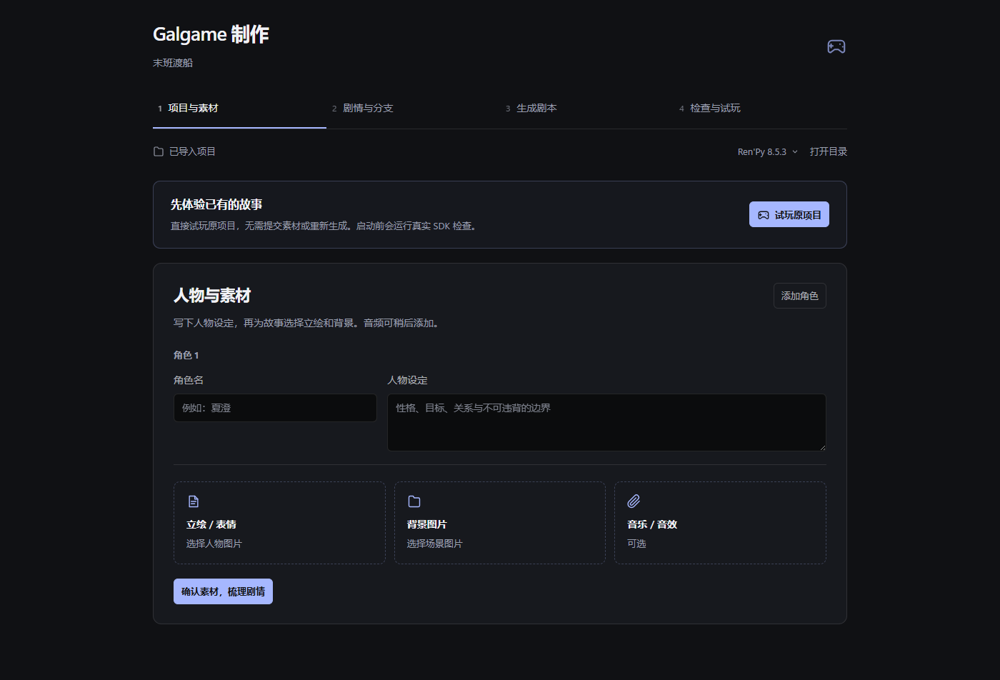

# 快速开始

## 安装与配置

从 [Releases](https://github.com/jhdsmb-del/DeepWriter/releases) 下载 Windows x64 完整包并解压。桌面安装版和免安装版在 `desktop`，CLI 运行 `cli/deepwriter.cmd`。

启动后打开 **设置 → 模型与接口**。用官方 DeepSeek，就选内置的 DeepSeek、填入 API Key，再选模型；用中转或其他服务，就单独添加供应商，填它的地址和它签发的 Key。编辑时留空不会清除已保存的 Key。切换到不同服务地址时，请为新地址单独设置凭据。

在 Agent 输入框左下角打开「更多工具」选择工作目录。首次使用可以先发一句不带附件的消息，收到回复后再开始处理稿件。

系统凭据存储必须可用。Windows 使用系统提供的加密设施；Linux 开发环境需要 Secret Service。若提示凭据不可用，先修复凭据存储或重新配置 Provider，不应通过关闭保护绕过。

## 中途改要求，不用停掉任务

普通 Agent 运行时，输入补充要求并发送。它会等正在执行的工具返回，再按新要求继续；停止按钮仍然是停止，不会被补充消息代替。要找很早提过的细节，可以直接问「我最初给的产品编号是什么？找出我的原话。」

新配置不设整项任务的次数、轮数、token、时长或金额上限。需要时再到 **设置 → 完成与预算** 打开某一项。联网默认用当前服务商支持的服务；要处理不宜联网的资料，可以点输入框的联网开关切为离线。思考保留“跟随模型”即可。

## 一份材料，两种写法

写说明文或指南时，先说清楚写给谁、读者需要做什么，以及哪些材料可以引用。例如：「给第一次值夜班的人写交接指南，用这份记录区分缺测与零值，没有的数字不要编。」如果要小说，可以说：「保持第一人称，只让守夜人知道他当场看到的事情。」不必切换模型；没有指明写法时，可以在梳理要求时选择，或自由填写。

## 让 Agent 按项目要求审稿

1. 在输入框的「更多工具」选稿件目录，打开「设置 → 项目约定」。写下每次都要遵守的要求，例如「只从小禾的视角写；信封上的名字对她保密」，保存并关闭。约定存在该目录的 `DEEPWRITER.md`。
2. 回到 Agent，打开「更多工具 → 只读审阅」，输入「找出第三章提前泄露寄信人的句子，列出原文和改法」。它能查稿，不能改文件。
3. 看过方案再点「批准执行」。若目录或约定已换，请按新项目重新审阅。完成后展开回复里的改稿记录，对照改前和改后的原文。想用回原稿，点「撤销这次改稿」；重开会话后，这个入口仍在。

同一文件连改两笔时，从最近的一笔开始撤销。如果其他改动已经改变了稿件，DeepWriter 会保留当前文件，不会用旧稿盖过去。

长文采访会记住开始时的约定。中途修改 `DEEPWRITER.md` 对新任务生效，不会改变已经确认的这本书。

## Agent

在「今天想写什么？」下面直接输入任务。比如“读取 README 和 package.json，解释如何运行这个项目”，或者“查一下这条消息最早的公开来源，给我原文链接”。Agent 可以读取、搜索文件、修改文件和执行命令；实际能力取决于工作目录、权限与配置。

点击输入栏的地球图标切换联网。显示「联网」时，查资料用的是当前模型供应商的账户，不用额外填搜索 Key。官方 DeepSeek 提供搜索和网页读取；接入原生搜索的 OpenAI Responses 和 Anthropic Messages 模型返回带来源链接的搜索结果。显示「未联网」时，点击图标打开模型设置。模型能聊天不等于能联网；自定义模型可以在「规格与连接」中测试工具调用，网关还需有已接入的搜索接口。

要读工程包，把 ZIP 拖入输入框，或点回形针选择。先问「列出目录，告诉我哪些文件能读」，再让 Agent 在这次任务里打开指定条目。图片、音频和程序文件可以列在目录里，但不会被当作正文或自动运行。长文页也可把 ZIP 当作参考材料。Excel 保留工作表名与单元格位置，PowerPoint 按演示顺序提取正文。工作目录里的 PDF 可读文字层，EPUB 按书中的阅读顺序提取章节；纯扫描页需要先做 OCR。

生成的文件可以就地打开：右键回复里的文件名，选「打开文件」或「在文件资源管理器中显示」。用键盘时先聚焦文件名，再按 Shift+F10。

在自动模式下，选定工作区中的普通文档可以直接读取、新建和局部改写。需要额外授权时，核对弹窗里的目标和操作，再选「允许一次」或「拒绝」。写入完成后查看差异；支持快照的文件修改可以从工具结果回滚。命令执行使用当前操作系统账户权限。

普通 Agent 显示回复和简短的执行状态。需要检查工具结果时展开“查看过程”，需要查看账单、事件或恢复原因时打开任务详情。运行期间可停止；取消命令会尝试终止其子进程树，已发生的外部副作用仍需自行检查。

输入框底部可以切换模型与思考强度。上下文按模型规格自动安排，不用再选「完整」「优化」或「极简」。要让某条信息一直参与对话，可以固定它；要看本次带了哪些材料，打开模型菜单中的上下文明细。

开始生成后，输入框下方显示 **tok/s** 和 **缓存命中**。带「≈」的是最近一秒流式输出的估算速度；请求结束时，有服务商用量就显示包含等待首个 token 在内的平均输出速度。命中率是该次请求已缓存输入 token 占输入 token 的比例；「—」表示没有可计算的数据，与 0% 不同。

处理多份资料时可直接说：「找出 notes 下面所有周报，把最新三份一起读一下，列出尚未解决的问题。」Agent 可以先按路径或文件名找资料，再一次读取多份；某个文件没能读取，其余文件仍可返回。

在回复下点 **文件来源**，可以对照实际查到的路径、行号和当时摘录。不同目录下的同名文件会分别显示。这里显示阅读记录，不会悄悄重读改过的文件；要看新版，告诉 Agent 再读一次。

未发送的文字和附件随会话保留，切换工作区或会话后可以继续编辑；发送失败会保留草稿。文字会自动保存，重启后可以恢复；附件需重新选择。保存失败时请使用“重试保存”，退出提示中可返回应用处理。长回复可上翻阅读，点击“回到最新”恢复跟随。界面遵循系统的“减少动态效果”设置。

## 长文

进入长文工作区，填写任务和目标字数。有参考原稿，就在这里添加素材，不用切去聊天上传。每篇稿件分别记住自己的素材；重新打开后，若看到「重新选择素材」，选择原文件即可接着写。

接下来，按 Grill Me 逐问澄清，回顾事实与假设，再确认大纲。确认后默认连续写正文、审校和收尾，需要授权、人工审阅或预算不足时暂停。字数支持快捷值与自定义值，范围为 2,000–2,000,000。

如果连接在一章中途断开，恢复原任务即可从已收稿处继续。要先拿走手上的稿子，点 **任务中心 → 任务详情 → 活动 → 另存草稿**。文件只收录已接受的正文。

检查场景状态、审核结果和版本后再导出。运行中更改设置不会改写任务的冻结配置；需要调整合同或模型时按工作流提示创建新的阶段或任务。

## 任务中心

任务中心用于检查运行记录、账单和恢复原因。若任务暂停、等待授权、用量未知或恢复受阻，先阅读具体原因并做出选择；未知副作用的步骤不能直接重放。

如果旧任务提示「已达到本次运行的 Provider 调用硬上限 16」，打开该任务的「详情 → 活动」，点 **解除调用次数限制并继续**。不必重新发送原问题。新任务默认不限调用次数；联网仍按供应商费率计费。

恢复入口基于持久化记录，不等同于重新发送上一条聊天消息。取消、放弃和恢复各有不同的结果。

## 创作工具

选择 **创作工具 → Galgame**，新建项目，或导入含有 game/ 子目录的旧项目。

**先试现成的故事。** 在 Galgame 工作室点「导入项目」，选完整包里的 `examples/last-ferry`。打开「剧情与分支」读两条路线；选好 SDK 后点「试玩原项目」。游戏在自己的窗口运行，回到工作室可以停止。想写自己的项目，再按下面的顺序制作。

1. 有 Ren’Py 就点「选择 SDK 目录」，选解压后的 SDK 根目录，不是游戏目录。找不到时可点「自动扫描」；没有 SDK 再点「下载官方 SDK 8.5.3」。
2. 填角色名和设定，分别选立绘、表情与背景，再梳理剧情、确认大纲和分支，开始制作。
3. 点「运行检查」检查脚本。要换版本，点项目名右侧的 Ren’Py 版本号，选另一套 SDK，再用它检查。素材、确认的大纲和已生成的脚本会保留。

本版在 Windows 实际使用 Ren’Py **7.8.7、8.5.2、8.5.3** 分别创建项目并运行过脚本检查。

## 数据与反馈

用户数据存放于 Electron 的 userData 目录，Windows 常见位置为 `%APPDATA%/DeepWriter`。备份时先退出应用，保存整个目录。工作目录中的项目与导出文件需要另行备份。卸载配置默认保留用户数据，手动删除前请确认备份。

遇到问题时记录版本、平台、触发步骤、预期与实际结果，通过 [Issues](https://github.com/jhdsmb-del/DeepWriter/issues) 反馈。截图、日志和任务内容中不要包含 Key 或私人文件内容。详见[隐私说明](PRIVACY.md)。
