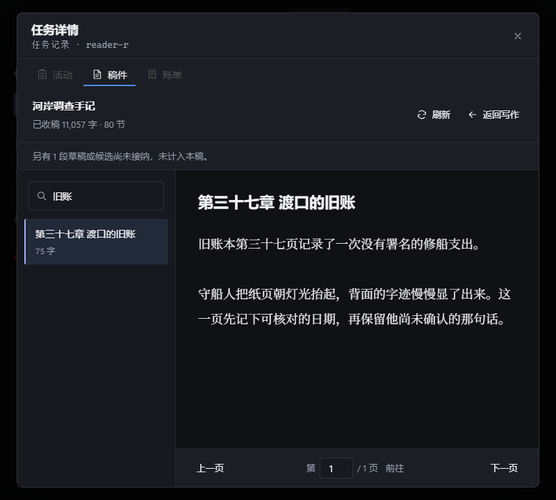

# DeepWriter 8.0.0

## 不用导出，也能翻到要读的那一章

打开 **长文 → 阅读已收稿**，或者在 **任务中心 → 任务详情 → 稿件** 找一份以前的稿子。在目录输入两个字，就能按章名筛选。点进一章可以翻页、跳到指定页，也可以直接翻到下一章。**返回写作** 会回到对应会话，不用重新找任务。

目录和页码只计算已经接纳的正文。正在写的段落、等你审的草稿不会混进来。阅读在本机完成，不调用模型。



## 让安装版自己找更新，什么时候重启由你定

从旧版升级，请先下载一次 **8.0.0 Windows 安装版**。从这版开始，安装版会在后台检查正式发布的新版本并下载。准备好后，可以继续用当前版本，也可以去 **设置 → 应用更新 → 重启并安装**。正在写作或工具仍在运行时不会为了更新停掉它们。普通退出不触发安装。

免安装版会提示新版本，点下载可以取得对应的便携程序，不会替换正在用的文件。两种版本都可以在 **设置 → 应用更新** 关闭自动检查。

## 只用终端，不必下载两个桌面程序

下载 **DeepWriter-8.0.0-cli-win-x64.zip**，解压后运行 `.\cli\deepwriter.cmd`。独立包自带 Node 运行时。已有的工作目录和会话不需要搬家。

```powershell
.\cli\deepwriter.cmd update check
New-Item -ItemType Directory -Force .\downloads | Out-Null
.\cli\deepwriter.cmd update download .\downloads
```

第一条显示当前版本和最新正式版。第二条将新版 CLI 压缩包存到指定目录，校验下载内容，不替你解压或覆盖文件。两条命令都不需要 API Key。

[快速开始](QUICKSTART.md) · [CLI 指南](CLI.md)
