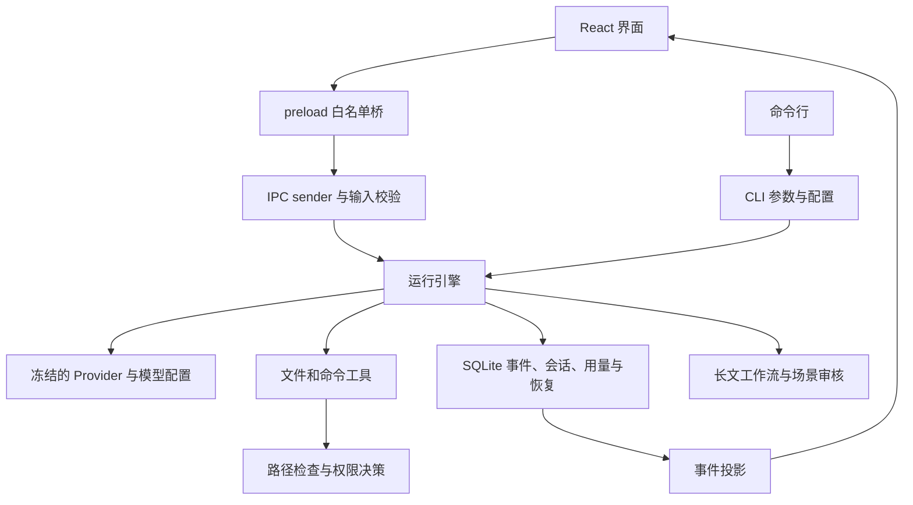

# 技术架构

DeepWriter 有 Electron 桌面和独立 Node.js CLI。两个入口共用 TypeScript 运行引擎，分别存放会话和凭据。长文与创作工具使用同一套文件、权限与恢复机制。

## 普通 Agent 的目标监督

Goal 与普通工作模式使用同一个运行引擎。开启 Goal 的运行才得到 `update_goal`：先保存用户原话和可检查的交付条件，接着执行；模型给出候选结果后，进入单独的验收轮。文件类成果要引用本次运行的真实工具回执，文字类成果可引用实际答复。缺项就继续，不能靠换一份更短的清单收尾。桌面和 CLI 从 SQLite 读取同一份目标状态。

这里借鉴了 [Codex 的续跑规则](https://github.com/openai/codex/blob/main/codex-rs/ext/goal/templates/goals/continuation.md)：判断实际进展，不把重述计划当进展。澄清借鉴 [Grill Me 的决策树](https://github.com/mattpocock/skills/blob/main/skills/productivity/grilling/SKILL.md)：先查事实，只把影响交付的选择留给人。「不提问」把本次任务的取舍交给模型，不产生跨任务的工具授权。

## 进程边界

Renderer 不直接获得 Node 能力，通过 `window.ds` 的明确接口调用主进程。主进程检查 sender、输入 schema、路径与授权。preload 和共享类型同步描述跨进程契约。

桌面 Provider 凭据由主进程使用系统设施加密，CLI 从明确配置的环境变量读取 Key，不读取桌面凭据。每次运行冻结模型、端点和凭据引用；修改当前设置只影响新运行。

## 运行与数据

运行引擎负责模型轮次、工具调用、取消、终态和恢复。SQLite 保存运行事件、会话与计费事实，UI 由这些事实投影，不独立猜测成功。未知副作用或缺失用量需要明确用户决策。

预算的规范化、准入与结算在 `jobs/providerBudgetPolicy.ts`，引擎负责锁、账本持久化和调用顺序。Provider 文件在 `providerConfiguration.ts` 解析并校验关联，`providerRegistry.ts` 再提交数据库事务、处理凭据。

Agent 的「优化」上下文把较早的大段只读工具输出投影为首尾摘录，保留最新两组调用及结果。投影位于工具记录落库之后、预算预留之前；不会改写任何历史、工具参数或运行状态。上下文账本按实际请求记录摘录和本地用量估算。设计参考 [OpenCode 的工具结果截短](https://github.com/anomalyco/opencode/blob/dev/packages/core/src/session/recent-text.ts)与 [Pi 的近期上下文保留](https://github.com/earendil-works/pi/blob/main/packages/coding-agent/src/core/compaction/compaction.ts)。

长文工作流在基础运行之上维护合同、阶段、场景审核与版本。长文目标字数与普通 Agent 状态分开，避免把普通任务描述为固定字数的生成任务。

## Agent 工具与宿主

新 Agent 将本地工具权限与两个联网工具名分别冻结。历史任务的本地通配符不获得网络权限。模型可见的工具和执行分发读取同一份快照；公开搜索和读取使用固定 Exa 服务，不向站点发送模型凭据。桌面设置的整表和单字段更新使用同一套 schema；文件交付由 `manuscriptDelivery.ts` 和 `exclusiveFile.ts` 处理，桌面与 CLI 保留各自原有文件名约定。

## 文件与命令

`agentTools.ts` 负责授权和工具结果。`agentFiles.ts` 负责有界读取与原子替换，`commandProcess.ts` 统一进程启动、输出、超时与取消。

文件写入先快照，再写同目录临时文件并替换，失败时清理临时文件。命令使用 `shell:false` 和参数数组；Windows 的 cmd/bat 启动保留专门的转义路径。取消和超时分别记录，POSIX 使用进程组，Windows 使用系统进程树终止命令。

这些机制减少误操作与不完整结果；不能替代操作系统级沙箱，也不能回滚任意命令副作用。

## 界面与加载

三个主要入口是 Agent、长文、任务中心。风格与 Galgame 位于创作工具菜单；设置、较重工作区、Markdown 与任务详情按需加载。共享工作区布局抽到独立组件，避免布局助手让可选工作区重新进入首屏依赖。

聊天默认展示回复与简短状态，工具过程默认折叠。进入与退出动画只在界面切换时运行，不随流式文本更新重新启动，并遵循系统减少动态效果设置。代码高亮只处理已知语言和有界代码块，未知语言保留普通文本。

未发送文字保存在独立 SQLite 草稿表中，不创建 canonical 消息或运行；按会话串行写入并用版本检查拒绝旧修改。退出前等待 Renderer 确认持久化，失败时允许返回应用重试。附件授权只保存在内存中，异步结果按会话归属合并。接受请求的事务只清除匹配的已提交文字，保留等待期间的新编辑；删除会话同时删除草稿。设置弹窗只提交实际修改字段，串行写入并读取规范化结果。

流式文本短时间合批，工具、替换与终态事件保持顺序；聊天列表独立订阅，已有消息复用。列表在自动跟随时响应 Markdown 布局增长，上翻阅读后保留位置，用户可以恢复跟随。

任务中心专注运行记录，不提供新的聊天发送框。长文合同中的字数输入与快捷值是实际可达的配置入口，规范化逻辑在 store 边界统一执行。

## 检查与发行

`npm test` 提供基础逻辑与 Agent 行为检查，`npm run check` 包含常规门禁、文档与生产构建，`npm run e2e` 使用真实 Electron 和本地模型服务。

Windows 发行工作流用实际安装包检查干净安装、旧版本升级、凭据解密、正常退出和卸载数据保留。通过后组装桌面与同版本 CLI，生成依赖与校验清单。[验证记录](VALIDATION.md)按版本记录结果。
